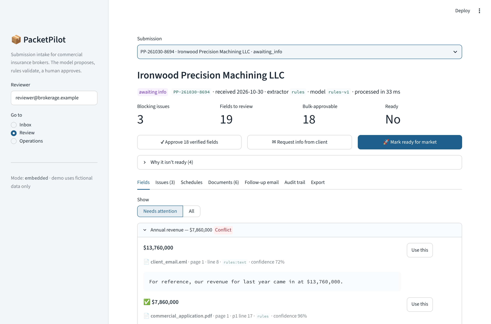
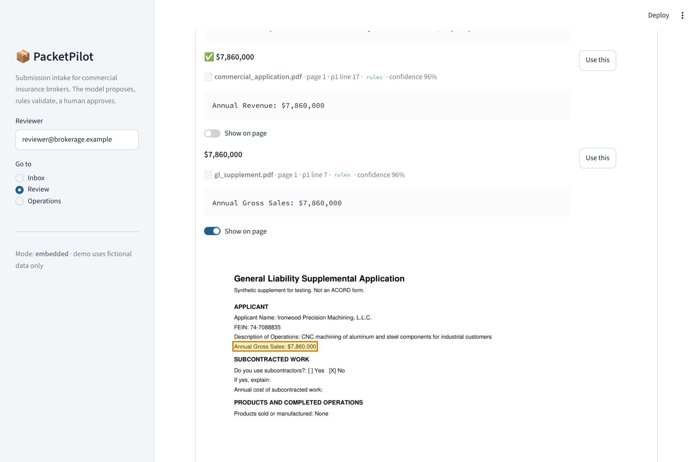
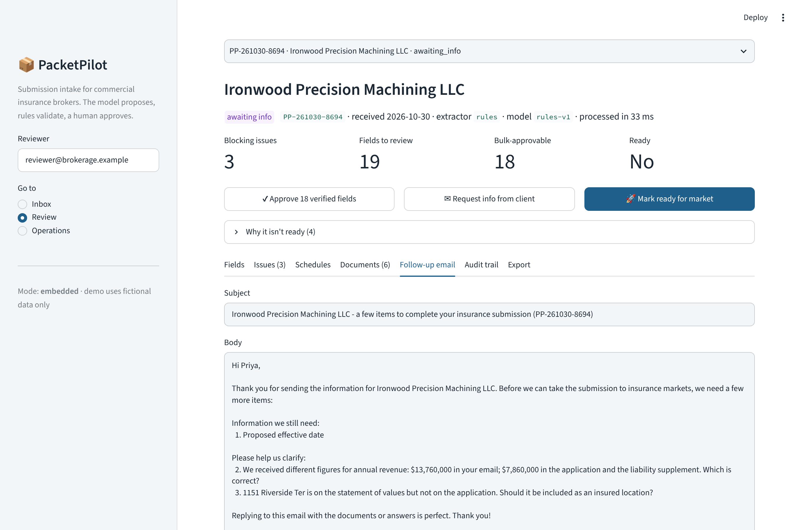
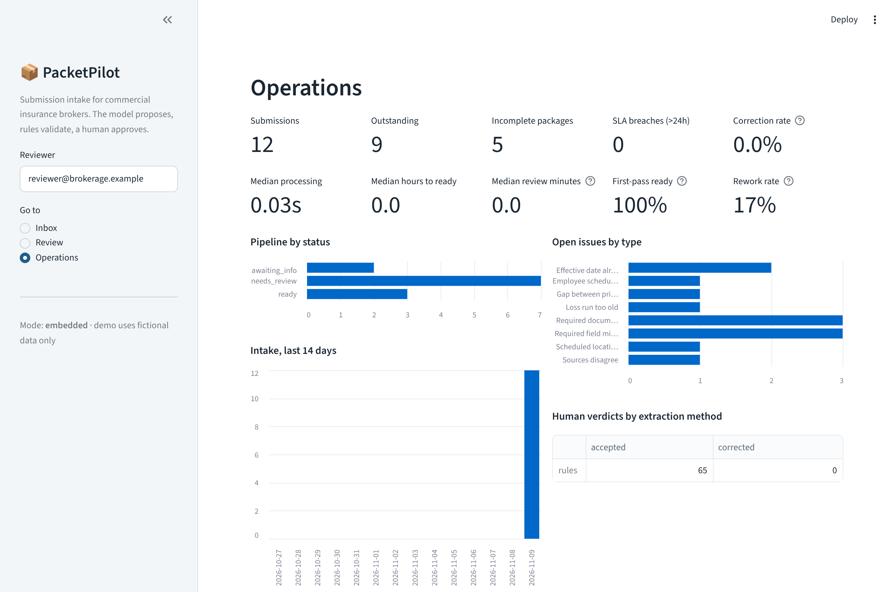
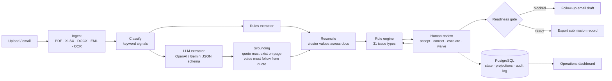

# PacketPilot

**Evidence-backed submission intake for independent commercial insurance brokerages.**

A new-business submission arrives as a pile of PDFs, spreadsheets, Word files and emails: an application, a
liability supplement, loss runs, a payroll schedule, a vehicle schedule, a statement of values and a few emails
explaining things. Someone has to read all of it, key it into one record, notice that revenue is $7.9M in the
application but $13.8M in an email, chase the missing payroll schedule, and only then send it to markets.

PacketPilot automates the information-processing part of that job and keeps a person in charge of every decision:

> **The model proposes. Deterministic rules validate. A human approves.**

It does **not** decide insurability, price risk or bind coverage. Brokers place risk with carriers; this tool
makes the brokerage's intake work faster and more reliable.



---

## What it does

| Stage | What happens |
|---|---|
| **Intake** | Upload a package (PDF, XLSX/CSV, DOCX, EML with attachments, images) or paste an email. Duplicates are detected by hash. |
| **Document intelligence** | Text-layer parsing with layout reconstruction; OCR (Tesseract) for scanned pages; transparent document classification with the signals that drove each decision. |
| **Extraction** | 24 canonical fields + loss-run claims, payroll by class, vehicles, locations and statement-of-values rows. Deterministic extractor out of the box; OpenAI or Gemini structured outputs when a key is set. |
| **Evidence** | Every value carries document, page, verbatim source line, bounding box, method and confidence. The reviewer sees the highlighted line on the page image. |
| **Grounding** | LLM quotes are checked against the parsed source. Invented quotes or values the quote doesn't support are marked *ungrounded* and block readiness. |
| **Reconciliation** | Values from different documents are clustered with type-aware comparison (money tolerance, "L.L.C." = "LLC"). Disagreement → conflict that a human must decide. |
| **Rule engine** | 31 issue types from deterministic checks: missing fields/documents, conflicts, payroll/headcount/vehicle mismatches, claim status contradictions, undisclosed losses, VIN check digits, stale loss runs, coverage gaps… |
| **Human review** | Accept, pick a source, correct (note required when no document supports it), escalate, waive with a note, reject a schedule row. Bulk-approve only fields that are high-confidence, grounded, digitally sourced and uncontested. |
| **Readiness gate** | "Ready for market" is refused until no blocking issue is open and every value has been approved by a person. |
| **Follow-up** | Client email drafted from open issues only, in client language (no internal file names), so it can't invent requests. |
| **Audit & ops** | Append-only audit log (who, what, before/after, model version). Operations dashboard: outstanding, incomplete packages, SLA breaches, time-to-ready, first-pass ready rate, rework rate, and the reviewer **correction rate by extraction method** — the live quality signal. |

| Evidence on the page | Client follow-up drafted from open issues | Operations |
|---|---|---|
|  |  |  |

## Measured results (synthetic benchmark)

48 fictional submission packages, 63 injected defects, generated and scored by code in this repo
(`make bench`). Full methodology and caveats: [docs/EVALUATION.md](docs/EVALUATION.md).

| Slice | Field accuracy | Silent errors | Issue recall | Issue precision | Evidence traceability |
|---|---|---|---|---|---|
| Styles A + B + scanned (42 pkgs) | **99.9%** | **0** | **100%** | **98.2%** | **100%** |
| Scanned / OCR only (8 pkgs) | 99.4% | 0 | 100% | 87.5% | 100% |
| Held-out phrasing, style C (6 pkgs) | 39.0% | **0** | 50%* | 10.0% | 100% |

\* Missing-field recall stays 100% on the held-out style; contradiction and validity checks that depend on fields
the deterministic extractor couldn't read are missed.

**Read these numbers honestly.** The generator and the deterministic extractor were written by the same person, so
in-distribution accuracy mostly proves the pipeline is wired correctly, not that it generalises. The held-out
style C exists to show what happens on an unfamiliar form: the rules extractor reads little, but it **fails closed**
— zero wrong values were auto-verified; everything it couldn't read became a "missing" issue that blocks readiness.
That's the case for running the LLM path (hybrid mode) in production, and it still hasn't been benchmarked with a
live model, because no API key was available while building this. Review-time savings against a manual baseline
haven't been measured with real people yet; [docs/EVALUATION.md](docs/EVALUATION.md) has the study protocol.

## Quick start

```bash
pip install -r requirements.txt && pip install --no-deps -e .
# OCR needs the tesseract binary: apt install tesseract-ocr  |  brew install tesseract

python -m packetpilot.bench.generate --out benchmark/packages     # 48 fictional packages (already committed)
python scripts/seed_demo.py --n 12                                # load some into the local SQLite DB
streamlit run streamlit_app.py                                    # reviewer UI, embedded mode
```

Other entry points:

```bash
uvicorn packetpilot.api.main:app --reload          # REST API, docs at http://localhost:8000/docs
packetpilot process benchmark/packages/PKG-003/*.{pdf,xlsx,eml} --as-of 2026-10-30 --followup
python -m packetpilot.bench.evaluate                # re-score the benchmark -> benchmark/results/RESULTS.md
pytest                                              # 90 tests
docker compose up --build                           # PostgreSQL + Redis + API + RQ worker + UI
```

To turn on LLM extraction, set `OPENAI_API_KEY` (or `GEMINI_API_KEY`). With `PACKETPILOT_EXTRACTOR=auto` (default)
the pipeline then runs **hybrid**: deterministic rules and the LLM both propose, and disagreements surface as issues.
See [.env.example](.env.example) for every setting.

## Architecture



FastAPI + Streamlit + PostgreSQL (SQLite locally) + Redis/RQ. No LangChain, no vector store, no agents: the hard
part is extracting correctly and knowing when not to trust the extraction, and none of those tools help with that.
Details: [docs/ARCHITECTURE.md](docs/ARCHITECTURE.md).

## Repository map

```
packetpilot/
  ingest/        parsers (PyMuPDF, openpyxl, python-docx, email, Tesseract) + layout reconstruction
  classify.py    document typing with explainable signals
  extract/       rules.py (deterministic) · llm.py (OpenAI/Gemini) · grounding.py (hallucination checks)
  reconcile.py   cross-document value clustering and status
  rules_engine.py  31 issue types + issue merge that preserves human decisions
  readiness.py   readiness gate + client follow-up drafting
  pipeline.py    pure end-to-end processing (no I/O)
  service.py     review workflow, audit log, analytics (used by API and UI)
  db/            SQLAlchemy models (PostgreSQL / SQLite)
  api/main.py    FastAPI
  worker.py      RQ background jobs
  ui/            Streamlit reviewer workspace + operations dashboard
  bench/         synthetic package generator and evaluator
benchmark/packages/   48 fictional packages + ground_truth.json each
benchmark/results/    RESULTS.md from the last evaluation run
docs/                 architecture, evaluation, deployment, demo script, customer-discovery kit
tests/                90 tests (unit, every defect type end-to-end, LLM grounding, service, API)
```

## Data and affiliation

All companies, people, FEINs, VINs, carriers, claims and documents in this repository are fictional and generated
by code. Phone numbers use the 555-01xx fictional range and email domains use the reserved `.example` TLD. Document
layouts are original; they collect information similar to ACORD 125/126 applications but don't reproduce any ACORD
form. PacketPilot isn't affiliated with any brokerage, carrier or ACORD.

## Status and next steps

Working prototype with tests, a benchmark and deployment config. Next, in order of value:

1. Run the benchmark in hybrid mode with a real model and publish the numbers next to the rules-only baseline.
2. Customer discovery with 8–10 brokerage operations people ([kit](docs/CUSTOMER_DISCOVERY.md)), then a timed
   review study against manual keying.
3. Real-world layouts: carrier-specific loss-run parsers and a small labelled set of public sample forms.
4. Outbound integrations (agency management systems, email intake) once the intake record format is validated.

MIT licensed.
