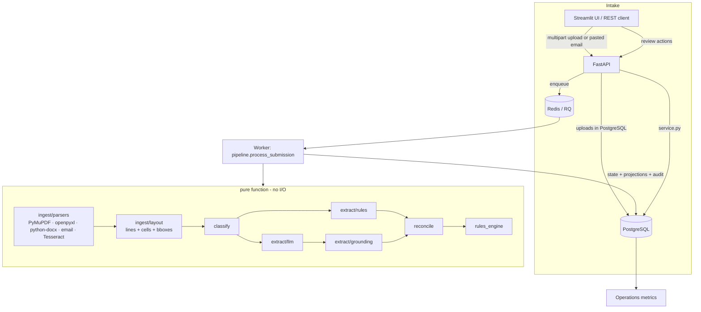
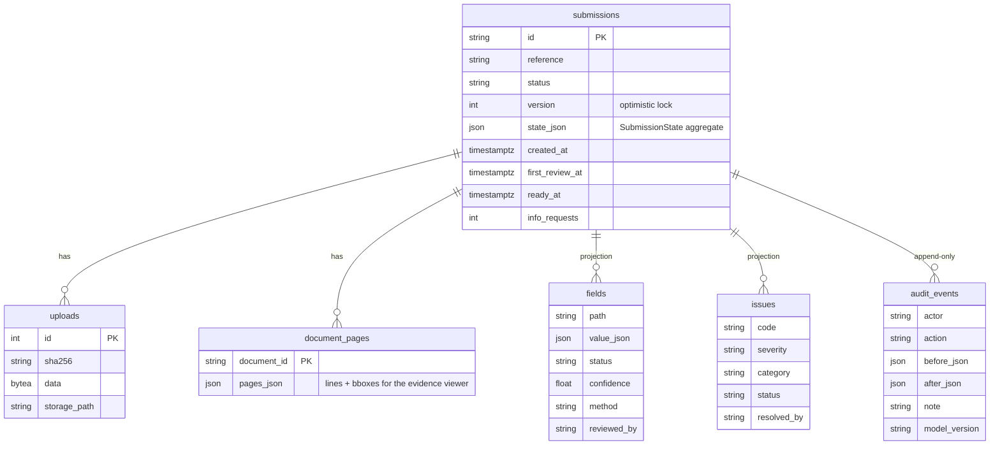

# Architecture

PacketPilot is a pipeline with one rule: **nothing reaches "ready for market" unless a person approved it, and
every approved value points at the line of the document it came from.**

## Components

### Ingest (`packetpilot/ingest`)
* **PDF**: PyMuPDF `get_text("dict")` gives spans with bounding boxes. `layout.py` groups spans into visual lines
  by vertical position and splits a line into **cells** wherever the horizontal gap exceeds 12 pt. That single
  representation handles `Label: value` forms, two-column forms and tables without a table-detection model.
* **Scanned pages**: any page with fewer than 25 characters of text layer is rendered at 300 dpi, despeckled with
  a 3×3 median filter and OCR'd with Tesseract (`--psm 4`). Words are grouped by Tesseract's own line ids (they
  follow skewed baselines better than a fixed y-tolerance). Word confidences are kept per line.
* **Spreadsheets**: each sheet is a page, each row a line, cells positional (so empty cells keep column
  alignment), locators like `Schedule!A7`.
* **DOCX**: paragraphs and table rows in document order. **Email**: headers + plain/HTML body, quoted replies
  dropped, attachments re-queued as documents of their own. Images are OCR'd directly.
* Parsing failures are caught per file and recorded as warnings; one corrupt PDF never fails a submission.

### Classification (`classify.py`)
Weighted keyword signals over the first two pages plus a filename hint. The output includes the signals that fired,
shown in the UI ("why this type"). Below a minimum score a document is `other`, which raises
`UNCLASSIFIED_DOCUMENT` rather than being forced into a type.

### Extraction (`extract/`)
Both extractors return the same thing: `Candidate(path, value, raw, Evidence)` for scalar fields and
`RecordState` rows for schedules. Raw strings always go through the same normalisers (`normalize.py`) so the two
paths are held to identical parsing rules.

* **Rules** (`rules.py`): a label dictionary per field (`Applicant Name`, `Named Insured`, …), inline
  `Label: value`, label/value cells, and label-on-its-own-line patterns; header-mapped tables for loss runs, payroll,
  vehicles and statements of values (including headers printed so close together they arrive as one cell); a small
  set of sentence patterns for emails ("revenue … $2.1M", "claim GL-2024-123 was closed"). It fails closed: if it
  can't find a label, it reports nothing.
* **LLM** (`llm.py`): one call per document with a strict JSON schema (OpenAI `json_schema` strict mode or Gemini
  `response_json_schema`). Every value must come with a page number and a verbatim quote. The prompt forbids
  inference and arithmetic.
* **Grounding** (`grounding.py`): the quote must exist on the cited page (exactly, or ≥0.9 similar on OCR pages;
  the page is corrected if it's found elsewhere), and the normalised value must be recoverable *from the quote*
  (the amount, date, number or text has to actually be in it). Failures are kept but marked
  `grounded=False`, confidence ≤0.3, which raises `UNGROUNDED_VALUE` and blocks readiness.
* **Hybrid** mode runs both. For schedule rows the deterministic rows win where both read the same table (they're
  reproducible); LLM rows fill tables the rules couldn't read. Scalar candidates from both are reconciled.

### Reconciliation (`reconcile.py`)
Candidates for a field are clustered with kind-aware equality: money within 2%, legal names ignoring entity suffix
punctuation (`L.L.C.` = `LLC`), long text with ≥0.85 similarity, line-of-business sets. A proposed value is chosen
by source priority (e.g. application before email), then grounding, then confidence. Status rules:

| Status | When |
|---|---|
| `conflict` | more than one cluster |
| `low_confidence` | ungrounded, unparseable, or confidence < 0.75 |
| `auto_verified` | confidence ≥ 0.90, grounded, not OCR-only, single cluster → eligible for **bulk** human approval |
| `extracted` | everything else → individual human review |
| `accepted` / `corrected` / `escalated` | human decisions, preserved across re-processing |

OCR-only values are never `auto_verified`: in an early benchmark run, two OCR misreads of long operations
descriptions were auto-verified because Tesseract reported high word confidence. This rule, together with
despeckling before OCR, brought silent errors on scanned packages to zero.

### Rule engine (`rules_engine.py`)
Plain Python functions over the submission state, each emitting `Issue`s with a severity, a category, evidence and
a **stable fingerprint** (code + field + subject + the values involved). `apply_issues` merges a fresh evaluation into
the stored issues:

* a human waiver/resolution is kept while the fingerprint is unchanged;
* an issue whose condition disappeared (e.g. the reviewer corrected the value) is auto-resolved with a note;
* a *changed* condition (a new conflicting value arrives) has a new fingerprint and opens as a new issue.

Field-driven issues (`FIELD_CONFLICT`, `UNGROUNDED_VALUE`, `LOW_CONFIDENCE`…) can't be waived directly; they clear
only when the field itself is reviewed, so there's no way to approve a submission while a value is unresolved.

Issue categories: `missing`, `contradiction`, `validity` (data quality, sent to the client follow-up), `review`
(extraction trust, internal), `document` (unclassified/unreadable/duplicate).

### Readiness and follow-up (`readiness.py`)
`assess()` lists blockers: every open critical or warning issue, every field with a value that a person hasn't
accepted or corrected, and escalations. `draft_followup()` turns open data-quality issues into a client email
grouped into documents needed, information needed and clarifications, using client-facing wording built from each
issue's structured `details` (no internal file names). It's a template on purpose: everything in it traces to an
issue.

### Service, API, worker, UI
* `service.py` holds every workflow rule (notes required for corrections not backed by a source, for waivers and
  escalations; optimistic locking via `expected_version`; editing a ready submission reopens it) and writes the
  audit log. The API and the embedded UI both call it.
* `api/main.py` is a thin FastAPI layer. Optional `X-API-Key`; reviewer identity in `X-Reviewer` (swap for SSO).
* `worker.py` enqueues `process_job` on Redis/RQ when `REDIS_URL` is set; otherwise FastAPI background tasks.
* `ui/` is Streamlit with a client abstraction: `HttpClient` (talks to the API) or `LocalClient` (in-process), so
  the same UI runs on Streamlit Community Cloud or in front of the full stack.

## Data model

The aggregate is stored as one versioned JSON document because it's always read and written whole during review;
`fields` and `issues` are rewritten projections so analytics are plain SQL (`GROUP BY code`, correction rate by
extraction method, etc.). Uploaded bytes live in PostgreSQL by default so API and workers share nothing but the
database and Redis.

## Design decisions

* **No LangChain, vector DB or agents.** Each document is small enough for one structured-output call; retrieval
  adds a failure mode without adding accuracy. The difficult parts — layout, normalisation, grounding,
  reconciliation, rules, review state — are ordinary code.
* **Deterministic first, LLM second.** The rules extractor gives a reproducible, free baseline and a regression
  gate. The LLM is there for layouts the rules haven't seen, which is where the held-out benchmark shows the gap.
* **Fail closed.** Unknown label → missing issue. Unreadable value → unparseable issue. Quote not in source →
  ungrounded issue. OCR-only → individual review. The benchmark tracks *silent errors* (wrong value marked
  auto-verified) as the key safety metric, and CI fails if it's above zero.
* **Brokerage, not underwriting.** No scoring, pricing or eligibility decisions anywhere in the code.

## Security and privacy notes

* Real submissions contain sensitive business and personal data. Before handling any: put the API behind SSO, use
  TLS everywhere, encrypt the database at rest, restrict who can read `uploads`, set retention, and sign a data
  processing agreement with the LLM provider (or use a zero-retention endpoint).
* LLM calls send document text to the provider. Rules-only mode sends nothing anywhere.
* The repository contains only synthetic data.
